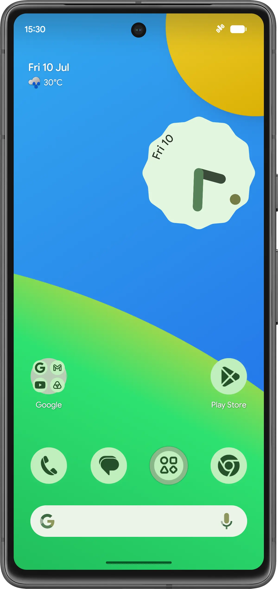
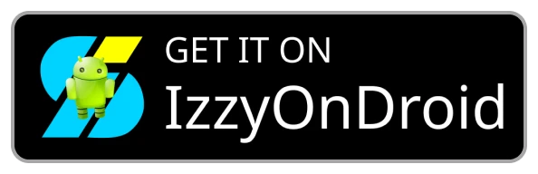
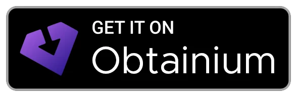

# Mellune 16

<picture>
    <!-- Avoid image being clickable with slight workaround -->
    <source media="(prefers-color-scheme: dark)" srcset="docs/assets/device-frame-dark.webp" width="250px">
    
</picture>

Mellune is a free, open-source home app for Android. Taking Launcher3—Android’s default home app—as a starting point, it ports Pixel Launcher features and introduces rich customization options.

This branch houses the codebase of Mellune 16, which is currently in development and is based on Launcher3 from Android 16. For Mellune 9 to 15, see the branches with the `9-` to `15-` prefixes, respectively.

## Features

- Material 3 Expressive theming that follows your wallpaper and system colors.
- At a Glance widget support, with integration for [Smartspacer](https://github.com/KieronQuinn/Smartspacer).
- QuickSwitch support for Android Recents integration on Android 15-16 (root required).
- Global search for apps, contacts, and web results from the home screen.
- Customization options for icon packs, fonts, and color settings.

## Download

  <a href="https://play.google.com/store/apps/details?id=app.mellune.play">
    <picture>
      <!-- Avoid image being clickable with slight workaround -->
      <source media="(prefers-color-scheme: dark)" srcset="docs/assets/badge-google-play.webp" height="60">
      
    </picture>
  </a>
  <a href="https://apt.izzysoft.de/fdroid/index/apk/app.mellune">
    <picture>
      <source media="(prefers-color-scheme: dark)" srcset="docs/assets/badge-izzyondroid.webp" height="60">
      
    </picture>
  </a>
  <a href="https://apps.obtainium.imranr.dev/redirect?r=obtainium://add/https://github.com/MelluneLauncher/mellune/">
    <picture>
      <source media="(prefers-color-scheme: dark)" srcset="docs/assets/badge-obtainium.webp" height="60">
      
    </picture>
  </a>
    <a href="https://github.com/MelluneLauncher/mellune/releases">
    <picture>
      <source media="(prefers-color-scheme: dark)" srcset="docs/assets/badge-github.webp" height="60">
      
    </picture>
  </a>

Mellune on Play Store will install as a different app compared to other sources. Features may be restricted to comply with Google Play’s publishing rules.

You can also [verify your installation](https://docs.mellune.app/getting-started/install-and-setup/verify) to check if you have installed an official build.

### Development builds

Interested in keeping yourself up-to-date with every Mellune development? Try our development builds!

These builds offer the latest features and bug fixes at a cost of performance and additional issues. Make backups before installing.

Download: [Obtainium][Obtainium link] • [GitHub][GitHub link] • [nightly.link][Nightly link]

## Sponsors

  <a href="https://coderabbit.link/mellune">
    <picture>
      <source media="(prefers-color-scheme: dark)" srcset="docs/assets/sponsor-coderabbit-dark.svg" width="300">
      
    </picture>
  </a>

[CodeRabbit](https://coderabbit.link/mellune) is an AI-powered code review platform that integrates directly into pull-request workflows and IDEs, examining code changes in context and suggesting improvements.

## Support Mellune

If you love what we do, consider [supporting us on Open Collective](https://opencollective.com/mellune)! Your contributions help keep Mellune independent and enable us to develop faster.

A huge thank you to our Core Backers ($5+):
*(These backers directly fund our Project Velocity Fund)*

[Become a supporter](https://opencollective.com/mellune) to help us cover our operational costs, or become a Core Backer to be featured here!

## Contribute

Visit the [Mellune contributing guidelines](CONTRIBUTING.md) for information and tips on contributing to Mellune.

## Quick links

- [Website](https://mellune.app)
- [Documentation](https://docs.mellune.app/)
- [News on Telegram](https://t.me/melluneci)
- [Discord](https://discord.com/invite/3x8qNWxgGZ)
- [X (formerly Twitter)](https://x.com/melluneapp)
- [_XDA_ thread](https://xdaforums.com/t/mellune-customizable-pixel-launcher.3627137/)

<!-- Download links -->
[Nightly link]: https://nightly.link/MelluneLauncher/mellune/workflows/ci/16-dev
[Obtainium link]: https://apps.obtainium.imranr.dev/redirect?r=obtainium://app/%7B%22id%22%3A%22app.mellune.nightly%22%2C%22url%22%3A%22https%3A%2F%2Fgithub.com%2Fmellunelauncher%2Fmellune%22%2C%22author%22%3A%22Mellune%20Launcher%22%2C%22name%22%3A%22Mellune%20(Debug)%22%2C%22preferredApkIndex%22%3A0%2C%22additionalSettings%22%3A%22%7B%5C%22includePrereleases%5C%22%3Atrue%2C%5C%22fallbackToOlderReleases%5C%22%3Afalse%2C%5C%22filterReleaseTitlesByRegEx%5C%22%3A%5C%22Mellune%20Nightly%5C%22%2C%5C%22filterReleaseNotesByRegEx%5C%22%3A%5C%22%5C%22%2C%5C%22verifyLatestTag%5C%22%3Afalse%2C%5C%22dontSortReleasesList%5C%22%3Afalse%2C%5C%22useLatestAssetDateAsReleaseDate%5C%22%3Afalse%2C%5C%22trackOnly%5C%22%3Afalse%2C%5C%22versionExtractionRegEx%5C%22%3A%5C%22%5C%22%2C%5C%22matchGroupToUse%5C%22%3A%5C%22%5C%22%2C%5C%22versionDetection%5C%22%3Afalse%2C%5C%22releaseDateAsVersion%5C%22%3Atrue%2C%5C%22useVersionCodeAsOSVersion%5C%22%3Afalse%2C%5C%22apkFilterRegEx%5C%22%3A%5C%22%5C%22%2C%5C%22invertAPKFilter%5C%22%3Afalse%2C%5C%22autoApkFilterByArch%5C%22%3Atrue%2C%5C%22appName%5C%22%3A%5C%22%5C%22%2C%5C%22shizukuPretendToBeGooglePlay%5C%22%3Afalse%2C%5C%22exemptFromBackgroundUpdates%5C%22%3Afalse%2C%5C%22skipUpdateNotifications%5C%22%3Afalse%2C%5C%22about%5C%22%3A%5C%22Mellune%20is%20a%20free%2C%20open-source%20home%20app%20for%20Android.%20(NOTE%3A%20This%20is%20the%20debug%20version%20of%20Mellune%2C%20for%20the%20beta%2Fstable%20versions%20see%20%5C%5C%5C%22Mellune%5C%5C%5C%22)%5C%22%7D%22%7D
[GitHub link]: https://github.com/MelluneLauncher/mellune/releases/tag/nightly
